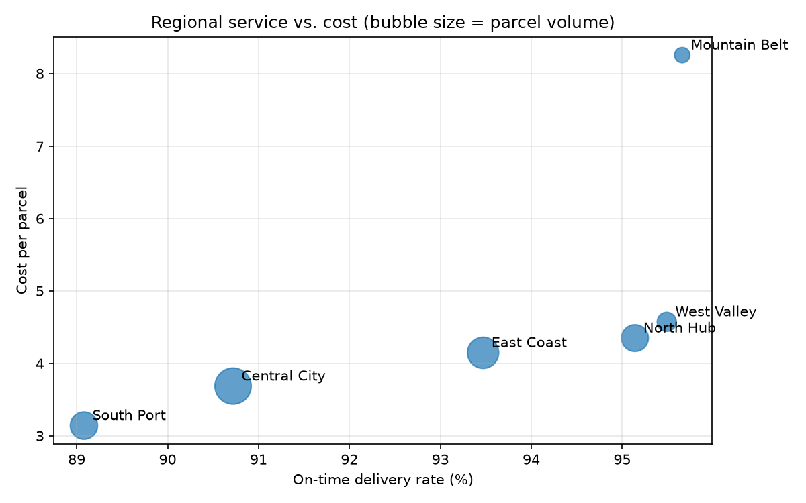
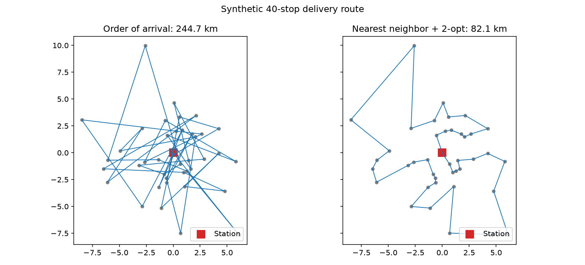
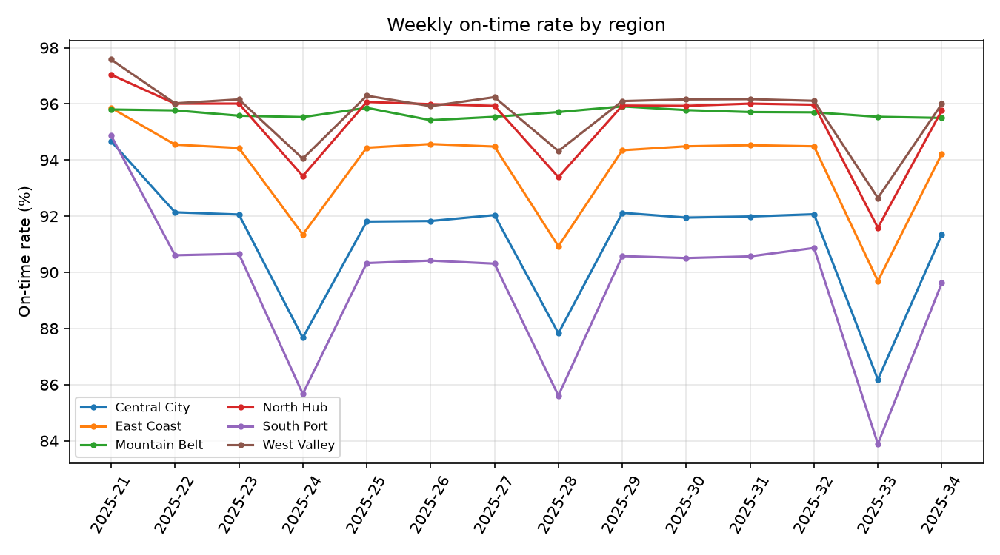

# Last-Mile Delivery Analytics

An end-to-end operations analytics pipeline for an express-delivery network. It covers KPI tracking in SQL, finding stations that cost too much to run, and optimizing delivery routes in Python.

> **Data note:** every number in this repo comes from `src/generate_data.py`, a seeded simulator. The regions, stations and costs are invented. This project uses no real company data. It recreates the *kind* of analysis I did during an operations analytics internship using a dataset I can share publicly.



## What it does

| Step | File | Output |
| --- | --- | --- |
| Simulate 90 days of ops for 25 stations in 6 regions (volume peaks, congestion, courier capacity) | `src/generate_data.py` | `data/daily_ops.csv`, `data/stations.csv` |
| Regional KPI rollup, station scorecard with window-function ranks, weekly trend | `sql/kpis.sql` (SQLite) | `reports/region_kpis.csv` |
| Flag stations whose cost per parcel sits more than 1σ above the network mean | `src/kpis.py` | `reports/flagged_stations.csv` |
| Sequence a courier's stops with nearest-neighbor construction plus 2-opt local search | `src/route_optimizer.py` | `figures/route_before_after.png` |
| Unit tests: data integrity, SQL vs pandas parity, optimizer correctness | `tests/` | `pytest` |

## Results on the synthetic network

| Region | On-time rate | Parcels / courier-hour | Cost / parcel |
| --- | --- | --- | --- |
| Mountain Belt | 95.7% | 3.6 | 8.26 |
| West Valley | 95.5% | 6.6 | 4.57 |
| North Hub | 95.1% | 7.1 | 4.35 |
| East Coast | 93.5% | 7.6 | 4.15 |
| Central City | 90.7% | 8.9 | 3.69 |
| South Port | 89.1% | 10.3 | 3.14 |

- **There's a trade-off between service and cost.** High-throughput regions (South Port, Central City) deliver parcels most cheaply but miss more delivery windows. The scatter above makes the frontier visible.
- **The cost outliers are a staffing problem, not a routing problem.** All three flagged stations are in Mountain Belt. Their couriers handle about half the parcels per hour that couriers elsewhere do, so the first lever to pull is capacity planning, not driver performance.
- **Stop sequencing matters.** Across 50 simulated 40-stop routes, 2-opt sequencing cut distance by a median of 68% compared with delivering in order of arrival. That baseline is deliberately naive. The useful result is that a few dozen lines of local search clearly beat an unsequenced route.





## Run it

```bash
python -m venv .venv && source .venv/bin/activate
pip install -r requirements.txt
python src/generate_data.py      # writes data/
python src/kpis.py               # SQL KPIs, flags, figures, reports/
python src/route_optimizer.py    # routing experiment + figure
pytest -q
```

## Stack

Python (pandas, NumPy, Matplotlib) · SQL (SQLite, CTEs, window functions) · pytest
